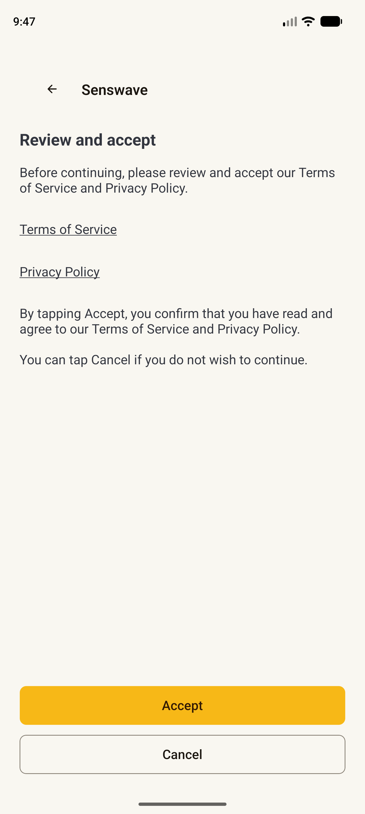
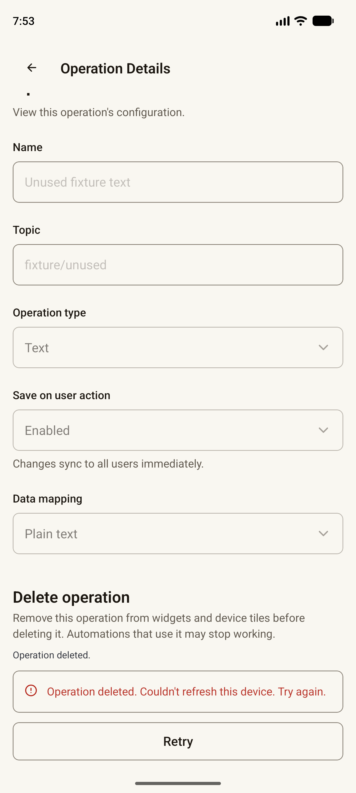
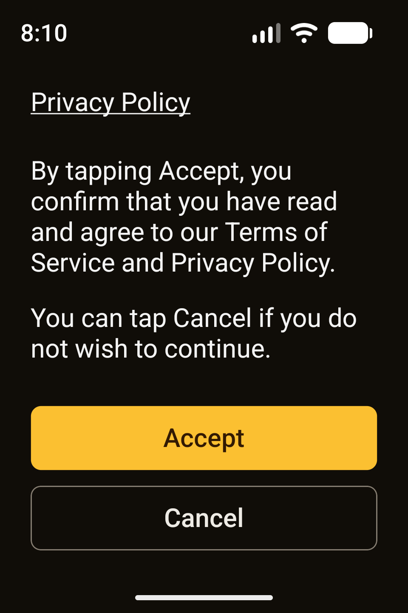

# UI audit remainder — native evidence and verification

**Status: Implementation, bounded Android verification, source checks, export and cleanup are recorded. The final whole-change Sol review of the evidence and documentation is pending, and no PR has been created.** Source `a705c23bf18243cd959f35e1759959f2d33367cd` contains the reviewed F1/F2/M1/F3 corrections plus a small App Info label change from Contact to Email. The scoped Sol review approved the correction wave through `8f4f7f4`; the final documentation addendum, including the label follow-up, still needs its requested review. This report does not claim final overall review approval.

The implementation completes the approved remainder: native consent and account recovery; account data sources and accepted Home assignment refresh; device Tile/Presence management and delete recovery; operation details, permissions and the compatibility route; email confirmation, shared legal pages, maintenance recovery and app information. No dependency, backend API field or navigation destination was added.

## Implemented scope

- Consent legal links and essential copy use readable local theme colors and wrapping. Acceptance is latched before account verification; Retry does not repeat the consent POST. Cancel and Back log out, including while the request is pending.
- Account source lists load once per focus. A source-row status error has compact local Retry that rereads only status and does not activate the row. Home source assignment remains owner-bound and accepted once; failed follow-up Home reads recover locally without repeating the PUT.
- Device configuration uses native Tile/Presence and operation selectors, preserves existing references, and keeps validation local. Accepted deletion disables the management row and its retained handler keeps context guards. The existing collection loader reports its completed read result for accepted-delete recovery.
- Operation details mount only a validated matching read. Delete is gated by current-home device and operation membership plus role. Accepted-delete recovery retries the matching read and navigation without another DELETE. The old `/device/operation/list` URL remains a headerless alias to `/device/widget/list`; the removed historical component is still pinned in the audit link below.
- Email confirmation preserves exact scalar link values, rejects ambiguous parameters locally, and supports Retry and Sign in. Public and private legal wrappers share the same server-owned content view. Maintenance waits for initialization and retries local version/auth recovery. App Info keeps metadata and legal links in one scroll; the final contact label is `Email` and retains the same configured value and destinations.
- Final source review findings F1, F2, M1 and F3 were corrected and scoped Sol-approved at `8f4f7f4`. The `a705c23` follow-up only shortens the App Info contact label and updates its rendered-value expectation; typecheck, lint and PoC were rerun afterward. The final whole-change documentation addendum remains unreviewed.

## Capture set and test fixture

The curated [manifest](assets/ui-audit-remainder/manifest.json) contains 38 actual PNG/XML capture pairs copied from the ignored runtime capture directory. Each record pins its capture time, exact source revision and source-file hashes, emulator profile, viewport, density, font scale, app theme, recorded system-night observation, fixture role/state, request counts, and image/XML hashes. The set keeps representative normal-size and IME evidence along with the compact recovery and legal cases. It excludes runtime JSON, raw logs, setup/login screens, token-bearing URLs, and screenshots of failed ANR runs.

Captures came from `emulator-5554`, Android 17 / API 37, x86_64. Physical display size was 1344 × 2992 at 480 dpi. Captured viewports include 448 × 997.33 dp, 640 × 800 dp, 320 × 800 dp and 320 × 480 dp. Capture theme and system mode are recorded per item; the guest reboot changed the service-reported night observation, so the report does not describe a restored custom binder label.

The fixture was disposable and local. It does not exercise a real account, production backend, broker, MQTT service or physical device. Android user 10 was actually stored as `Codex`, serial 12, created around 09:06 UTC; the intended descriptive full label was not stored. Existing users 0 and 11 were preserved. The owned QA user 10 was removed after it was stopped. The overnight runtime reset removed old `/tmp` captures; historical observations below remain explicitly historical and are not republished as fresh screenshots.

### Baselines, source assignment and device reachability

The normal-size Light consent and public Privacy baselines are captures 010 and 013. Captures 027/028 show the accepted Home source assignment: the PUT stays at one while the matching Home GET advances from three to four after Retry, then the app returns to Home. Capture 034 shows Device details’ final controls above a fully docked Gboard at 448 dp Light. Capture 107 shows Delete above the fully docked Gboard at 320 dp Dark/font 1.3; the Gboard font-size banner is system UI, not app feedback.

The 320 dp Dark/font 1.3 source-row error and recovery are shown in 108/109 on source `93d7652`; Retry advances only the affected client-status GET. Captures 110/111 show the helper beneath the full-width source chooser header and the healthy legacy alias screen on that same source. Later source changes did not alter these captured source-list states.

[Accepted assignment error](assets/ui-audit-remainder/027-home-source-accepted-error-clean-448-light.png) · [Home after recovery](assets/ui-audit-remainder/028-home-source-recovery-return-448-light.png) · [Source-row error](assets/ui-audit-remainder/108-source-header-status-final-320-dark-large.png) · [Source-row recovery](assets/ui-audit-remainder/109-source-header-retry-final-320-dark-large.png)

### Device and operation access and recovery

Capture 124 shows Device recovery within the 448 dp content cap at 640 dp Light. Capture 119 shows Owner Cancel/Back on the operation deletion dialog with zero DELETE requests. Capture 121 shows the eligible Manager Delete action/footer; the dialog was not opened. Capture 123 shows Display’s read-only operation view without Delete. Capture 065 preserves the old operationId-only link behavior: it opens read-only details without Delete. The audit retains the original pinned [OperationList file at the audited commit](https://github.com/SenswaveLabs/Mobile/blob/4855e9a89f068d2a439a77e8575bbb6a64bc525d/src/components/device/operation/OperationList.tsx#L43), which was removed when the route became an alias.

Captures 127/128 show one accepted operation DELETE, a matching-device read returning 503, local Retry, and successful return after the matching read. Across the retry cohort the DELETE count remains one and the matching GET reaches two. Captures 129/130 show the corresponding accepted device DELETE and collection-read recovery; Save, Manage and Delete are disabled while local Retry remains, then Home appears after the collection read succeeds. The DELETE count remains one and the collection GET reaches two. These critical recovery screenshots are pinned to `8f4f7f4`; the later `a705c23` change only changes the App Info label.

[Operation recovery](assets/ui-audit-remainder/128-operation-accepted-retry-return-final-448-light.png) · [Device recovery error](assets/ui-audit-remainder/129-device-accepted-read-error-final-448-light.png) · [Device recovery to Home](assets/ui-audit-remainder/130-device-accepted-retry-return-final-448-light.png)

### Consent, legal documents and App Info

At 320 × 480 dp Dark/font 1.3, capture 148 shows the full consent copy without ellipsis, its Cancel notice, and the Accept and Cancel actions. Capture 149 shows an accepted consent POST followed by an account GET 503 with local Retry; 150 shows recovery to Home with the POST still at one. During a separate delayed request, capture 152 shows Cancel still available while the 15-second delayed POST is pending and one POST despite a double press. Capture 153 shows Start after cancellation and late server completion; no account GET followed cancellation. The server-side accepted write is not rolled back by Cancel, but the late result does not rehydrate the account or navigate into the app.

Public Terms and Privacy ends and private Terms and Privacy ends are represented by captures 145, 147, 134 and 136 respectively. Android Back from public Terms and header Back from public Privacy return to the consent gate. These documents use invented fixture content, not a production policy. Capture 013 separately shows the normal-size public Privacy Version state.

Capture 151 is the final-source App Info reachability proof: `Email`, the complete configured address and the full 48 dp Privacy row are visible at the short viewport. Capture 142 is not used to claim bottom-row reachability because Privacy is offscreen there.

[Accepted consent read error](assets/ui-audit-remainder/149-consent-accepted-read-error-final-320x480-dark-large.png) · [Home after account-check Retry](assets/ui-audit-remainder/150-consent-accepted-retry-home-final-320x480-dark-large.png) · [Start after Cancel and late completion](assets/ui-audit-remainder/153-consent-cancel-late-result-final-320x480-system.png) · [App Info last row](assets/ui-audit-remainder/151-info-privacy-reached-final-320x480-dark-large.png)

### Email confirmation and maintenance

Captures 137/138 show a Unicode confirmation fixture returning 503, local Retry, then success. Both attempts retained known fixture values and scalar parameters; no link values are reproduced here. Captures 156/157 show an empty confirmation code rejected locally and navigation to Sign in without a confirmation POST. On a development-client cold start, the URI first opens the Expo project selector; no product request occurs until the cached local project is selected. Captures 159/160 show the resulting verification-pending and success states after selecting the cached local project, with one confirmation POST and fixture checks for known, exact scalar values. This verifies development-client cold selection only. Cold release APK delivery and browser domain association remain unverified.

Unauthenticated maintenance version GET 503 and explicit Retry-to-Start are shown in 154/155 at the short viewport; there were two version GETs and no auth-refresh POST. Capture 139 is retained only as the compact maintenance error layout: later edge-inside gestures caused a second service check and the app reached Home before the planned explicit second Retry, so it does not prove a separate deliberate Retry transition.

[Unicode confirmation Retry state](assets/ui-audit-remainder/137-confirmation-unicode-retry-final-320x480-dark-large.png) · [Confirmation success](assets/ui-audit-remainder/138-confirmation-unicode-success-final-320x480-dark-large.png) · [Maintenance Retry to Start](assets/ui-audit-remainder/155-maintenance-unauth-start-final-320x480-dark.png) · [Cold development-client success](assets/ui-audit-remainder/160-cold-confirmation-success-final-320x480-dark.png)

## Historical recovery failures and native instability

Historical captures 068–070 on `210d77b` record the accepted operation-delete defect: after one accepted DELETE, a matching-device GET returned 503 and the route returned to Widgets instead of retaining local recovery. Captures 072 and 074 were not passes: 072 missed the non-clickable section label and sent no DELETE; 074 included a developer LogBox. Captures 075/076 on `59cb891` show the repair. Historical capture 077 on `59cb891` similarly reproduced accepted device DELETE followed by collection GET 503 and immediate return to Widgets. Captures 079/080 on `ec47b34` show the collection-loader repair. Current recovery captures 127–130 supersede those older passes for the shared recovery behavior; the earlier history is preserved here with its true outcomes.

Captures 112–115 on `93d7652` record real Android ANRs before entering the intended operation screen. PID 2843’s input wait implicated `HardwareRenderer`/`RenderProxy` and an emulated EGL surface; after an app restart but before the guest reboot, a fresh PID also stalled before Home. The graphics trace suggests an emulator graphics stall, but the cause is unproven and does not establish product innocence. This is distinct from the earlier intermittent fatal `ScreenContentWrapper contains null child at index 2`; two unchanged-source 409 flows and the later `collapsable={false}` candidate passed selected flows but do not prove that fatal cannot recur.

After the guest reboot, the selected post-reboot flows completed, including operation first/last reachability and the accepted operation/device recovery cases. The retained final PID 7472 log contains 433 lines, with zero matches for fatal exceptions, null-child messages or `URIError`; `dumpsys activity lastanr` reported no ANR since boot. These bounded log results do not establish statistical absence or identify the earlier ANR cause.

## Checks, export and cleanup

The latest owning-source checks passed:

| Command | Result |
| --- | --- |
| `pnpm typecheck` | exit 0 on `a705c23` |
| `pnpm lint` | exit 0; 290 files, on `a705c23` |
| `pnpm test:poc` | 103/103 on `a705c23` |
| `pnpm test:data-sources` | 75/75, before the shared-guard relocation and optional-reading follow-up |
| `pnpm test:device-details` | 242/242 on `8f4f7f4` |
| `pnpm test:homes` | 83/83, before the shared-guard relocation and optional-reading follow-up |
| `pnpm test:dashboard` | 53/53 on `8f4f7f4` |
| `pnpm test:icons` | 30/30 on `93d7652`, before `8f4f7f4` |
| `pnpm test:automations` | 82/82, before the shared-guard relocation and optional-reading follow-up |
| `pnpm test:build` | 2/2 |

The later `a705c23` change is limited to the Info label and its existing lookup; typecheck, lint and PoC were rerun on that source. The `8f4f7f4` optional-reading follow-up also passed typecheck, lint, PoC, device-details and dashboard checks. Data-sources, Home and automation checks above are their last recorded results; they were not repeated after the helper relocation or optional metadata correction. The icons suite last passed after the helper relocation but before `8f4f7f4`; the build suite was not repeated after the final Info-label change. Existing Node `MODULE_TYPELESS_PACKAGE_JSON` warnings remain in `src/utils/authValidation.ts` and `src/utils/dashboardGrid.ts`.

The documentation integrity pass checked 60 local Markdown targets with no missing links. It verified 38 manifest records, all 76 selected PNG/XML files byte-identical to their runtime captures, and 48 source-file hashes across six revisions against Git. Both `git diff --check` and `git diff --cached --check` passed for this documentation commit.

A first production export ran before the fixture environment override was removed and was discarded. After removing task-owned `.env.local`, the final clear-cache Android production JavaScript export exited 0 with 55 assets. Its bundle is `_expo/static/js/android/index-e70bc39924d360fd1d624aed6f540a7e.hbc`, 8,868,342 bytes, SHA-256 `aef6a4273f246c9332da3cf00d94190e750cc141c9e61830c202a46cc2220f27`. The final bundle scan found no QA origin matches for `127.0.0.1:18080`, `10.0.2.2:18080`, `localhost:18080` or source-fixture values.

Cleanup was verified against the saved baseline. The original `.env` was unchanged; task-owned `.env.local` was removed. API port 18080 and QA Metro 98093 were stopped, and the API reverse was removed. Normal Metro is restored at port 8081 with the original `.env`; the original app was not launched. Android users 0 and 11 remain; task-owned user 10 was removed after `stop-user -w -f`. Physical size 1344 × 2992 and density 480 were restored. User 0 font scale remained 1.0 and its stored night fields (`1`, `-1`) were not changed; no night-setting command was issued. The service later reported `Night mode: no` after guest reboot/profile switch, so exact restoration of the old `custom_bedtime` binder label is not claimed.

## Limits and pending review

- The native evidence is bounded to the listed screens, fixture transitions, viewport and settings. It is not TalkBack, real-backend/account, production broker/MQTT or hardware verification.
- Cold delivery is verified only in the development client after selecting its cached project. A cold release APK and browser domain association are unverified.
- The earlier emulator graphics ANR and intermittent null-child fatal remain of unknown cause. Later selected passes are not evidence that either issue is cured or statistically absent.
- Source review approved the corrective F1/F2/M1/F3 wave. The whole-change Sol documentation/evidence addendum, including the final App Info label follow-up and this public report, is still pending because the reviewer tool reported its usage limit. No overall review approval is claimed. Root will retry the requested Sol review once the documentation checkpoint is committed. If it remains unavailable, the authorized fallback is a Draft PR with the review gate plainly pending; no replacement reviewer, merge or release is authorized.
- The plan remains open until the final review gate and PR publication are recorded. This report does not claim that a PR already exists.

## Decision appendix

These 16 decisions follow the order recorded in the task progress. Each includes the practical cost if it was wrong. The former stop-on-error requirement is superseded by the later direct user instruction to keep diagnosing, fixing and retesting while reporting failures. The earlier process-only environment assumption is corrected by the observed `.env.local` override and its verified removal.

1. **Use the approved plan as task decomposition.** The user had approved the direction and asked the team to continue, so no new product choice or repeated permission gate was needed. **Cost if wrong:** implementation might proceed while a product choice remained unresolved; the source and final evidence reviews remain the checks against that risk.
2. **Authorize the planned TDD RED and follow the later user error instruction.** The original ruling said unexpected failures require notification and a human pause. The user later directly instructed the team to continue diagnosing, fixing and retesting errors without asking again. That instruction supersedes the pause requirement for this work. **Cost if wrong:** continuing could alter a real regression before human review; preserve failing outputs and report material failures honestly.
3. **Prefer the connected GitHub PR tool when its structured body is sufficient.** Higher-priority tool preference changes the publishing mechanism, not the approved PR content. **Cost if wrong:** an unavailable or insufficient tool could delay review or omit needed context.
4. **Keep native verification distinct from handler tests.** Missing native evidence is a verification task, not a reason to broaden product scope; native QA was recorded independently of handler checks; final review remains pending. **Cost if wrong:** tests alone could miss rendering, navigation or keyboard defects.
5. **Guard delayed theme reset at its real commit point.** The optional session predicate is checked inside ThemeProvider after SecureStore deletion; no-argument callers and existing persistence behavior remain unchanged. Validate consumed consent at the UserProvider boundary. **Cost if wrong:** late work could overwrite a newer session’s theme or a wider reset change could break callers.
6. **Correct the QA environment record.** Expo continued emitting the old override after process changes, so the task used ignored `.env.local`; original `.env` remained unchanged. The task override was removed before the final export. This supersedes the earlier process-only assumption. **Cost if wrong:** refresh could target the wrong service or fixture origins could enter the production bundle.
7. **Complete the in-progress consent type default before commit.** The false default for `hasActiveConsent` completed a client type change already underway; typecheck and the required checks were rerun. **Cost if wrong:** incomplete context state could misrepresent consent, or a compile error could be hidden by an early commit.
8. **Use the mounted authenticated HomeProvider plus captured home ID as the current session boundary.** Token rotation within that provider lifetime is the same account; a future account switch without provider teardown needs an explicit generation key. **Cost if wrong:** stale Home data could cross accounts, or valid same-account refreshes could be discarded.
9. **Extend the existing native component harness only for focus lifecycle tests.** Its modules argument accepts a factory invoked once with harness React while existing object mocks remain valid; tests register real effect setup and cleanup. **Cost if wrong:** fake focus behavior could hide lifecycle defects, or unneeded harness complexity could spread.
10. **Normalize confirmation links at Expo Router’s native-intent boundary.** The installed router decodes absolute query values before the screen; only recognized confirmation links are normalized, other valid routes remain unchanged, and malformed confirmation parameters reach local recovery. **Cost if wrong:** external links could be altered or rejected; real parser and native link coverage were required.
11. **Key request identity by public scalar values.** Confirmation uses server/user/code, legal reads use kind/server; capture the current method at checked invocation and retain focus/scalar guards. Recreated context objects alone do not cancel valid work. **Cost if wrong:** stale work could run after a true identity change, or legitimate retries could be cancelled; a future public semantic boundary needs an explicit key.
12. **Preserve uncertain Android profiles after the runtime reset.** Users 0 and 11 were preserved; only task-created user 10, stored as `Codex` with serial 12, was owned and removed. Lost `/tmp` artifacts were not presented as current evidence. **Cost if wrong:** an old disposable profile may remain, but deleting an uncertain profile could erase personal app data.
13. **Make Task 4’s existing per-device refresh return success or failure.** `refreshDevice` now returns a boolean for the validated matching-device read while live-update callers may ignore it. Capture 070 reproduced accepted DELETE plus matching GET 503 and premature return; `59cb891` added local recovery, with current-source replay in 127/128 and one DELETE. **Cost if wrong:** a valid read could be rejected or a failed read could be treated as success, stranding recovery.
14. **Reuse Task 3’s collection loader for awaited device-delete recovery.** Preserve `refresh(): Promise<boolean>` and await the same loader rather than duplicate GETs; keep accepted writes latched. Capture 077 reproduced collection GET 503 and premature return; `ec47b34` awaited the loader, with current-source replay in 129/130 and no repeat DELETE. **Cost if wrong:** callers could observe success too early or overlapping reads could corrupt loading/cache; preserve pending, failure, latest-read and home-change coverage.
15. **Accept valid backend-default Display reading metadata.** The initial shared consumed-shape guard rejected omitted/null labels and omitted units that DeviceForm already defaults to empty strings. `8f4f7f4` allows those optional values while retaining record/ID checks and the eight-reading regression. **Cost if wrong:** malformed metadata could break rendering, while requiring omitted values could block valid existing devices.
16. **If the final Sol documentation/evidence gate remains quota-blocked, publish only a Draft PR with that gate explicitly pending.** Do not substitute another review model or claim overall approval; do not merge, release or delete this plan workspace before the gate closes. **Cost if wrong:** documentation or evidence inconsistencies could remain despite passing source review and machine checks; mitigate with candid Draft status, verified links/hashes/cleanup/export and preserved review records.
